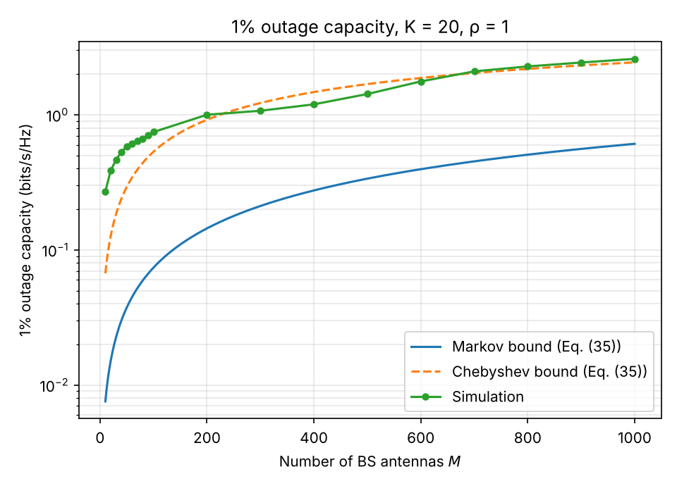
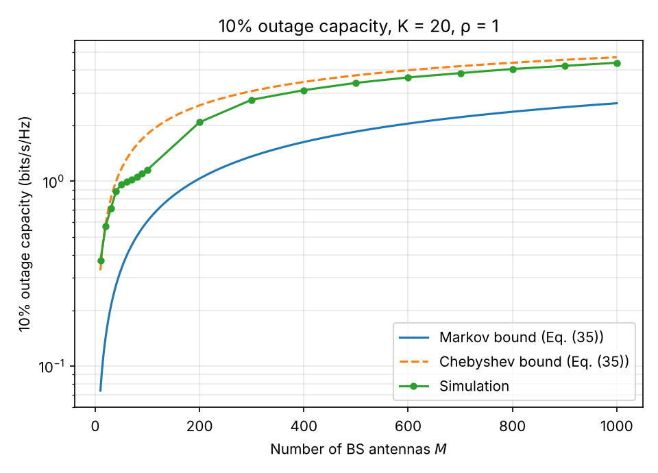
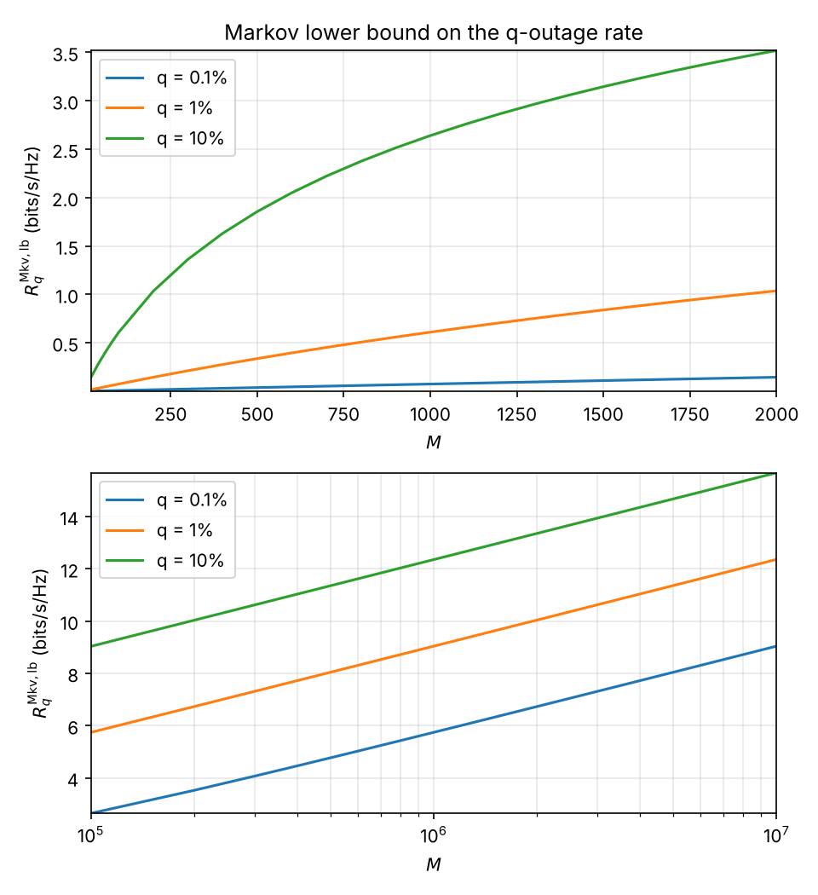
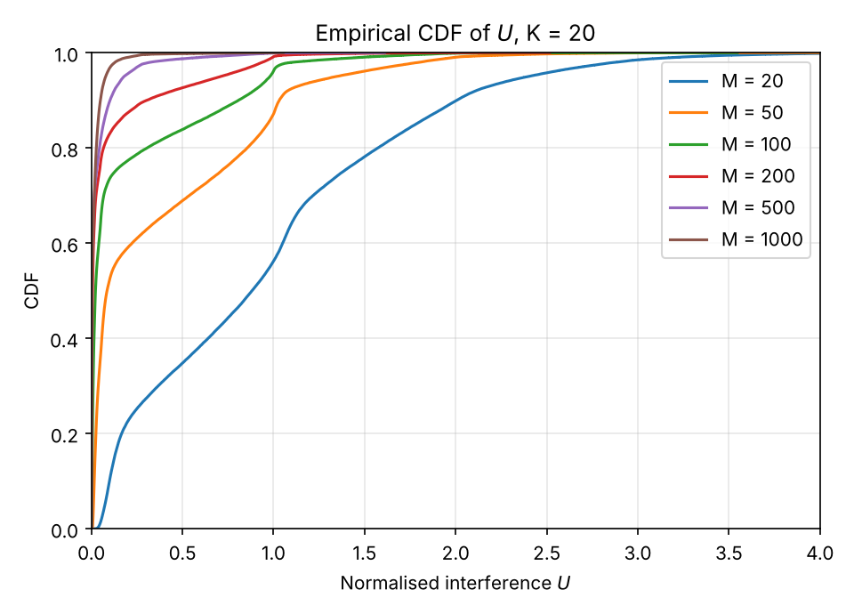

# Massive MIMO LoS Outage Capacity

Simulation code for the outage capacity of a line-of-sight (LoS) massive MIMO uplink with
maximum-ratio combining (MRC), where the users (for example drones) are spread uniformly in
3-D space around the base station (SPAWC 2017).

Original MATLAB code by Prabhu Chandhar, Chandhar Research Labs, Chennai, India.
The `python/` folder has a NumPy port that reproduces all of the figures.

## System model

| Parameter | Value |
|---|---|
| Carrier frequency | 2.5 GHz (λ = 0.12 m) |
| BS array | M-element uniform linear array, spacing λ/2 |
| Users | K = 20 single-antenna users, uniformly distributed inside a sphere of radius 500 m |
| Channel | Pure LoS, near-field (Fresnel) phase model |
| SNR | ρ = 1 (0 dB) |
| Monte-Carlo trials | 100,000 per value of M |

The channel from user *k* to antenna *m* is

$$g_k[m] = \exp\!\Big(-j\frac{2\pi}{\lambda}\Big(d_k + \frac{m^2\delta^2}{2d_k} - \delta(m-1)\cos\phi_k\Big)\Big)$$

where $d_k$ is the user's distance and $\cos\phi_k$ is its direction cosine relative to the array axis.
With MRC the normalised interference seen by user *k* is

$$U = \frac{1}{M^2}\sum_{j\neq k} |g_j^H g_k|^2 ,$$

and the *q*-outage capacity is

$$C_q = \log_2\!\Big(1 + \frac{1}{\eta_q + 1/(M\rho)}\Big),\qquad \Pr(U > \eta_q) = q .$$

## Repository layout

```
├── Calc_SPAWC2017.m        MATLAB: Monte-Carlo interference terms |g_j^H g_k|^2
├── outageCalculation.m     MATLAB: outage threshold from the empirical CDF
├── SPAWC2017_MRC.m         MATLAB: main script, Figures 1–4
├── python/
│   ├── los_outage.py       Python: channel model, interference, outage capacity, bounds
│   ├── make_figures.py     Python: main script, writes Figures 1–4 to figures/
│   └── requirements.txt
└── figures/                Generated figures (PNG) and results.npz
```

## Running the Python code

```bash
cd python
pip install -r requirements.txt
python make_figures.py                 # full run, 100k trials (about 15 minutes)
python make_figures.py --trials 20000  # quicker run
```

Options: `--trials`, `--K`, `--rho`, `--fc`, `--seed`, `--out`. The simulated capacities are also
saved to `figures/results.npz`.

## Results

### Figure 1: 1% outage capacity vs. number of BS antennas


### Figure 2: 10% outage capacity vs. number of BS antennas


Figures 1 and 2 compare the simulated outage capacity with the Markov and Chebyshev lower bounds
of Eq. (35). Capacity grows with M as the user channels become closer to orthogonal. The Markov
bound is a valid but loose lower bound. The Chebyshev curve, as written in the MATLAB code, lies
above the simulation for much of the range (see the notes below).

### Figure 3: Markov lower bound on the q-outage rate


$R_q^{\mathrm{Mkv,lb}} = \log_2\big(1 + M\rho / (\rho(K-1)/q + 1)\big)$ for q = 0.1%, 1% and 10%,
for moderate M (top) and very large M up to 10⁷ (bottom). It grows as log₂ M.

### Figure 4: CDF of the normalised interference U


As M grows the distribution of U concentrates near zero, which is the favourable-propagation effect
of a large array in LoS.

## Notes on the Python port

* **User distances.** In `Calc_SPAWC2017.m`, `radii(lp,:)` picks a single element of the column
  vector `radii`, so each user keeps the same distance in every trial. The Python code draws a new
  distance per trial (uniform in the sphere's volume), as the model describes.
* **SNR in Figure 1.** `SPAWC2017_MRC.m` uses `rho` in Figure 1 before defining it; ρ = 1 is used,
  as in Figures 2 and 3. The simulated capacity also uses `1/(M ρ)`.
* **Chebyshev bound.** The expression is copied as written in the MATLAB code
  (`sqrt((K-1)(M-1)(2M-1))/3/M/q`). It lies above the simulated capacity for much of the range
  (especially at q = 10%), so it does not behave as a lower bound here. The MATLAB expression may
  differ from Eq. (35) of the paper (for example in where the square root closes), so check it
  against the paper before relying on it.
* MATLAB's `cdfcalc`-based threshold is replaced by `numpy.quantile(..., method="inverted_cdf")`,
  which gives the same empirical (1−q)-quantile.
